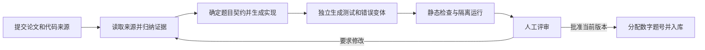

# Paper submission harness

用户提交论文链接、可选的官方代码链接，以及希望练习的核心方法。系统生成一个可实现、可验证的候选题目包，经过隔离验证和人工评审后才加入题库。

公开发布前还必须完成 CPU/WASM 浏览器适配，验证完整参考解、原始测试和全部错误变体。原生隔离验证通过本身不代表可发布；未适配的候选题继续留在候选区。接入要求见 [浏览器判题](browser-judge.md#publishing-a-new-module)。

该流程与做题者的编辑器、运行测试流程分开。做题者不需要导入报告，也不需要在本地整理题目文件。

## 1. 生成流程



每次生成分为三次模型调用：

1. **来源归纳**：读取论文与提交者提供的官方代码链接，整理公式位置、张量形状、实现约定、代码路径和许可证观察。专门寻找正文、附录和作者 notebook 中的 toy，记录论文版本、图号、代码路径与可获得的 commit、数据分布、模型、训练预算和指标。无法读取的来源必须标明，论文中的示意图不能冒充已经找到可运行源码。
2. **题目与实现**：从证据中选择一个规模有限的练习，生成中英文题面、明确的函数签名、starter、参考实现、讲解，以及“主张 → 来源 URL → 公式或代码位置”的对应关系。
3. **测试设计**：独立调用只收到题目契约和来源归纳，不读取参考实现。生成接口、已知值、数学性质与小规模行为测试，以及具有具体数学错误的实现变体。

题目契约必须说明输入输出 shape、dtype、归一化、时间方向、mask、梯度归属、边界和数值容差。论文与官方代码不一致时，应明确本题采用哪个约定，留给评审者核对。

当前适配器使用 OpenAI Responses API：[Structured Outputs](https://developers.openai.com/api/docs/guides/structured-outputs?api-mode=responses) 约束候选包结构，[Web search](https://developers.openai.com/api/docs/guides/tools-web-search) 提供来源检索。模型由服务器配置，不在浏览器中保存密钥。模型回复和网页内容都不具备批准、入库或执行宿主机命令的权限。

## 2. 候选包和验证

候选材料保存在 `.paperleet/submissions/`，与 `problems/` 中可做的题目分开。生成成功仅表示得到候选内容。

| 材料 | 用途 |
| --- | --- |
| 论文和官方代码链接、原文摘录、练习目标 | 保留提交上下文 |
| 来源归纳及引用位置 | 支持人工追溯论文依据 |
| 中英文题面、函数契约、starter、参考实现、讲解 | 组成可阅读、可作答的练习 |
| 分层测试和错误变体 | 检验正确实现，并验证能否发现已知错误 |
| Toy 来源、改动说明与实际运行产物 | 追溯实验依据，观察本次代码运行的曲线、散点和指标 |
| 内容哈希、验证报告、人工评审记录 | 把验证与批准绑定到同一版本 |

静态检查先拒绝格式错误、无效签名、缺失测试层、无依据的测试结构和不允许的代码形态。它只是一道检查，不能替代执行隔离。

执行验证使用专用 Docker 镜像：无网络、非 root 用户、只读文件系统、限制 CPU / 内存 / 进程数，并设置运行时限。容器不接收模型 API 密钥，不挂载完整仓库或用户目录。依赖在构建镜像时安装，生成代码不能自行安装依赖。

验证要求参考实现通过全部测试、starter 不能通过全部测试、每个错误变体至少被一个真实断言抓到。参考实现重复验证两次；当前候选包包含 4–16 个覆盖 T0–T3 的测试与 2–4 个错误变体。测试运行还要完整结束，导入失败、收集失败和进程退出不能伪装成有效的错误检出。Docker 不可用时保留候选内容，显示验证阻塞，禁止批准入库。

### Toy 契约与运行产物

新生成的候选包包含 `toy` 对象，其来源类型必须明确：

| `toy.kind` | 含义 |
| --- | --- |
| `author_toy` | 已核实存在作者提供的可运行 toy；定位到对应代码路径或 notebook |
| `paper_derived` | 根据论文中的实验设置重新实现；原论文的图不等于官方源码 |
| `teaching_adaptation` | PaperLeet 新设计的教学实验，用来检查论文核心性质 |

`source_url` 必须来自候选包已列出的证据，`locator` 给出具体公式、图、章节或代码位置，`adaptation` 说明数据、模型、步数等删改；没有改动也须明确说明。来源归类是否真实、缩减后是否仍覆盖论文贡献，由人工评审确认。

旧测试的 `def test_name(impl)` 保持兼容。需要保存产物的测试使用 `def test_name(impl, artifact)`，例如：

```python
def test_toy(impl, artifact):
    # Inputs and expected behavior are part of the independently designed test.
    inputs = torch.arange(8, dtype=torch.float32)
    measured = impl.add(inputs, 2)
    artifact("addition_toy", {
        "kind": "toy_experiment",
        "title": "Synthetic addition",
        "samples": torch.stack((inputs, measured), dim=-1),
        "metrics": {"mean": measured.mean()},
    })
    torch.testing.assert_close(measured, inputs + 2)
```

这只是说明 fixture 的合成测试，不是一个科研题目。真实 T3 应调用本次 `impl`，执行小规模数据生成、优化或可解析行为实验，再保存实际结果。不能写死一条“正常收敛”曲线，也不能把参考输出当作学生输出。可视化产物采用 `kind: "toy_experiment"`，支持 `metrics`、`loss_curve: [[step, loss], ...]`、`samples: [[x, y], ...]` 与 `reference_samples`，只填写适用字段。测试仍必须有独立的断言，生成图表本身不算通过。

容器内的可信 worker 自动把候选包的 `toy` 来源写进实验产物，覆盖测试自行填写的来源。可接受有限 JSON 值、NumPy 数组与小型实数 PyTorch 张量；张量 detach 后转换为 JSON 副本。每个测试最多 4 个不重名产物、合计 32 KB，整份报告最多 256 KB；单产物最多 4096 个节点、嵌套 12 层，拒绝 NaN、Infinity、循环引用和超大数组。超限会让测试失败，不静默截断科学数据；测试作者应明确抽样或汇总。宿主机接收容器报告时再次检查这些限制，网页服务器不因此导入 PyTorch。

有 `toy` 的新候选包必须在 T3 使用 artifact fixture，参考实现的两次隔离验证都必须产生带对应来源的 `toy_experiment`。产物通过现有 `report.tests[].artifacts` 返回；发布后的学生实现同样在容器中生成自己的产物。没有 toy 的旧候选包继续使用原测试契约。Toy 元数据与测试源代码都是候选内容哈希的一部分，修改它们后必须重新验证和人工批准。

## 3. 人工评审门

人工评审在网页中查看来源、题面、实现、测试、错误变体和验证结果，然后填写评审者及意见。批准前必须确认：

- 公式、算法和源码位置确实支持该题目的数学主张。
- 本题约定足够明确，题面、starter 与参考实现一致。
- 测试覆盖核心性质和常见错误，容差合理，能够接受合法的不同实现。
- 教学内容与来源使用方式适合入库，必要的出处和许可信息已核对。
- Toy 的来源分类和实验改动准确，图表来自实际执行的提交代码，断言能发现核心方法的错误。

模型不能提交人工批准。后端会再次验证当前候选哈希与通过验证的哈希一致，且人工评审材料完整；任一条件不成立就拒绝入库。重新生成会使旧验证和旧批准失效。

批准后才写入 `problems/community/paper_<submission-id 前 12 位>/` 并重新导出题库。新题使用现有最大题号加一，已发布题号保持不变。做题者看到数字题号，目录标识继续用于草稿、报告和内部关联。

当前版本面向单人本地使用：本地工作区所有者担任评审者。多人部署前需把人工评审 API 接入经过认证的评审角色、审计记录与独立执行服务；仅增加一个评审者姓名输入框不能建立多人权限隔离。

## 4. 本地配置

先按仓库 README 安装依赖。为启动服务的终端配置 `OPENAI_API_KEY` 和 `PAPERLEET_MODEL`，后者必须是该账户可调用、支持所用能力的模型 ID。密钥只通过环境变量提供，不放进源码或前端。

启动 Docker 后，在仓库根目录构建验证镜像：

```bash
docker build -t paperleet-harness:local paperleet/submissions
make dev
```

如需自定义镜像名，设置 `PAPERLEET_SANDBOX_IMAGE`。网页会显示生成服务和隔离环境是否就绪；缺少配置时仍可保存提交，补齐配置后再生成或验证。

已入库的社区题目通过网页或 `paperleet test <数字题号>` 在同一个隔离环境中判题。当前批量 `ci` / `mutate` 与可视化生成命令仅支持维护者编写的原始题目包；遇到社区代码会停止，而不会退回宿主机执行。

增加 artifact fixture 后需重新构建上述镜像。可在不调用模型 API 的情况下运行合成候选包的真实容器回归：

```bash
PAPERLEET_DOCKER_HARNESS_TESTS=1 .venv/bin/python -m pytest tests/test_submissions.py -q
```

## 5. 验证范围

自动测试使用临时题库与模拟模型/沙箱返回值，覆盖状态转换、失败恢复、人工评审门和旧版本批准拒绝。它们验证流程约束，不证明模型生成的数学内容正确。

Artifact 回归另检查有限数值、尺寸限制、张量副本、来源绑定、缺失实验输出拒绝，以及真实容器内从验证到已发布题目报告的合成链路。未配置 Docker 的常规测试跳过最后一项。此支持没有接通托管版在线生成/审核角色，也没有自动发布参考图；社区题目的图表来自隔离执行报告。付费模型的实际科研候选生成仍需独立验收。

真实模型生成需要有效的模型配置；真实隔离执行需要可用的 Docker 服务与构建好的镜像。两者均通过后仍需要人工评审，不能把模型生成成功或 pytest 全绿等同于论文正确性。
